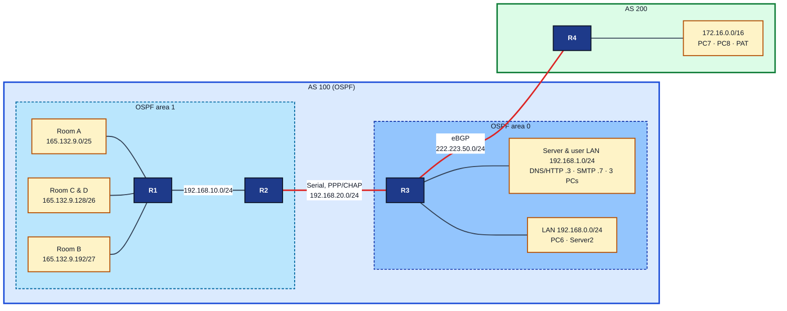
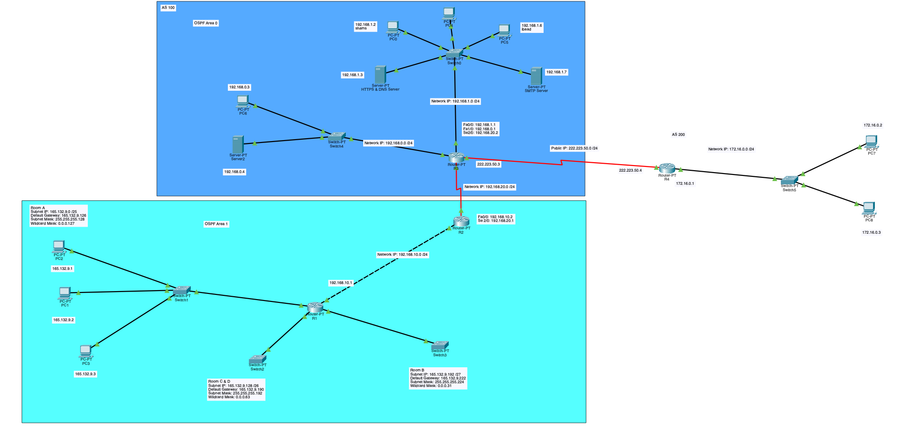

# OSPF, BGP & NAT Network Lab (Cisco Packet Tracer)

A two-autonomous-system network I built in Cisco Packet Tracer during the **Introduction to Computer Networks** course at EPITA (BSc, Spring 2025). It grew one layer at a time over exercises 6 to 17. Once it was built, I reviewed the whole design from a security and operations angle. That review and the next iteration it points to are documented below.

**Concepts:** VLSM subnetting · multi-area OSPF · eBGP · PPP with CHAP · ACLs · static NAT and PAT · DNS · SMTP/POP3 · ARP and ICMP analysis

## Topology





> **Reading the screenshot:** the dark-blue box labelled "AS 100" only surrounds OSPF area 0. Packet Tracer wouldn't let me resize it. AS 100 actually includes **both** OSPF areas: R1, R2 and Rooms A–D (the light-blue area 1 box) are part of AS 100 too. AS 200 is only R4 and its 172.16.0.0/16 LAN on the right. The Mermaid diagram above shows the correct grouping.

The Packet Tracer file is [`topology/two-as-network.pkt`](topology/two-as-network.pkt) (Packet Tracer 8.2 or later). The router running-configs are in [`configs/`](configs/).

## Project scope

The goal was one working network that covers layer 2 through the application layer, with every protocol configured by hand.

| Ex | What I built | Where it is |
|---|---|---|
| 6 | ARP: empty cache, ping, cache populated | PCs on 192.168.1.0/24 ([screenshot](docs/arp-before-after-ping.png)) |
| 7 | PPP with two-way CHAP authentication | R2 ↔ R3 serial ([R2](docs/chap-r2-serial.png), [R3](docs/chap-r3-serial.png)) |
| 8 | VLSM: 165.132.9.0/24 split for 100, 50 and 25 hosts | R1 interfaces |
| 9–10 | RIPv2, then replaced with OSPF in two areas | R1 in area 1, R2 as ABR, R3 in area 0 |
| 11 | ICMP echo and destination-unreachable analysis | [echo request](docs/icmp-echo-request-pc3.png) |
| 12 | Second autonomous system with an eBGP peering session | R3 (AS 100) ↔ R4 (AS 200) |
| 14 | ACL: deny all traffic to one host | ACL 100 on R1 ([admin-prohibited reply](docs/acl-admin-prohibited.png)) |
| 15b–16 | DNS, HTTP and email servers, two mail users | 192.168.1.0/24 behind R3 |
| 17 | Static NAT publishing the servers, PAT for AS 200 clients | R3 and R4 |

## Addressing

| Segment | Network | Gateway |
|---|---|---|
| Room A (sized for 100 hosts, 3 PCs placed) | 165.132.9.0/25 | .126 |
| Room C & D (sized for 50 hosts) | 165.132.9.128/26 | .190 |
| Room B (sized for 25 hosts) | 165.132.9.192/27 | .222 |
| R1 ↔ R2 | 192.168.10.0/24 | |
| R2 ↔ R3 (serial) | 192.168.20.0/24 | |
| Server & user LAN | 192.168.1.0/24 | .1 |
| LAN behind R3 | 192.168.0.0/24 | .1 |
| R3 ↔ R4 (serial) | 222.223.50.0/24 | |
| AS 200 LAN | 172.16.0.0/16 | .1 |

Static NAT on R3: DNS/HTTP server 192.168.1.3 → 222.223.50.8, mail server 192.168.1.7 → 222.223.50.9.

## What works

- **The VLSM plan is correct.** Subnets are allocated largest first, and the OSPF wildcard masks on R1 match them exactly.
- **OSPF is properly split into two areas**, with R2 as the area border router.
- **CHAP authenticates both ways.** Both serial ends show `LCP Open` and `Open: IPCP, CDPCP`.
- **The ACL works.** Traffic to the blocked host gets an ICMP *Administratively Prohibited* reply from R1.
- **Email works end to end.** Both mail users exchanged messages through the SMTP/POP3 server.
- **AS 200 clients use the server's public NAT address as their DNS server**, not its private one.

## Security and design review

After building the network I reviewed it the way I'd review one I was responsible for. These findings are in the current `.pkt` file. They define the next iteration.

| # | Finding | Why it matters |
|---|---|---|
| 1 | **The DNS A record for `mohammad-ibaad.net` returns the private address 192.168.1.3.** | External clients in AS 200 resolve the name to an address they can't route to. The fix is split-horizon DNS: public answers outside, private answers inside. |
| 2 | **AS 100 advertises no prefixes over eBGP.** The session is up, but R3 has no `network` statement. | Reachability currently depends on the shared link subnet. In a real deployment the public service range would be advertised explicitly. |
| 3 | **The published servers aren't filtered.** Static NAT exposes every port on 222.223.50.8 and .9 to AS 200. | NAT is not a firewall. An inbound extended ACL should allow only web, DNS and mail and log everything else. |
| 4 | **No management-plane hardening.** There's no `enable secret`, no VTY authentication and no SSH, and the lab passwords are stored in plaintext. | Anyone on the network could take over a router. |
| 5 | **Efficiency and housekeeping.** ACL 100 is applied inbound on four interfaces where one outbound ACL would do. An empty `router rip` stanza is left over, and R4 still has its default hostname. | Cleaner configs are easier to audit. |

[`review-findings.md`](review-findings.md) has the configuration I'd use for each finding. It's written but not yet applied or tested in the `.pkt`.

## Files

```
topology/two-as-network.pkt   the Packet Tracer file
configs/R1.txt … R4.txt       router running-configs exported from the file
docs/                         topology and screenshots taken during the exercises
review-findings.md            proposed config for the review findings (not yet applied)
```

All credentials in the file are throwaway lab values that aren't used anywhere else.
